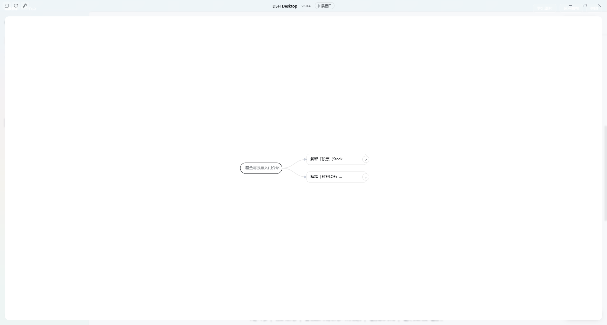
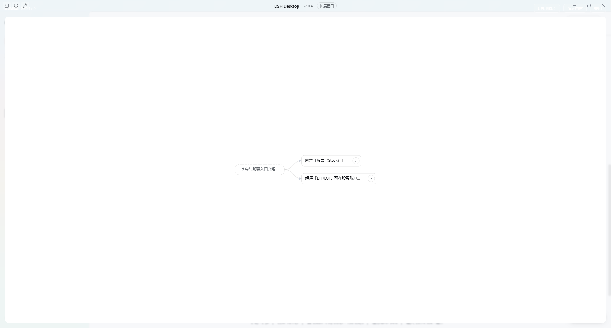
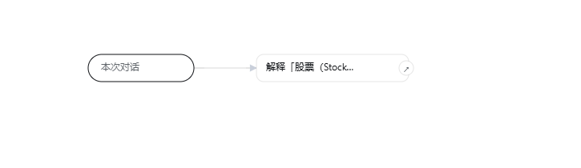

# DSH Question Map

**Select any text in a DSH conversation to ask a context-free side question — and watch every question you asked grow into a browsable network graph.**

A community plugin for [DeepSeek Harness](https://github.com/deepseek-ai/deepseek-harness) (`dsh`), for **DSH Web and DSH Desktop**.

English | [中文](README.zh.md)

---

## The problem

LLM conversations are linear. You ask one question, get five paragraphs back, and one term in the third paragraph is
unclear — so you ask about it in the same thread. Ten minutes later the original question is far above the fold, the
context is huge, and you only ever wanted to understand **that one word**.

This plugin lets you **select a fragment of text → click “Ask” → get a separate, empty-context mini conversation**
that answers just that. Every question remembers which text it came from, and all of them form a graph you can browse.



## Features

| | |
|---|---|
| **Ask about a selection** | Select text in the transcript; a small “Ask” button appears next to it. The popover anchors to the selection. |
| **No inherited context** | Each question is a brand-new session with only *the term plus a short quote around it*. |
| **Keep chatting in the popover** | Follow-ups stay in the same side session and never disturb the main thread. |
| **Branch by selecting again** | Select text inside an answer to spawn a child question — the graph grows by itself. |
| **Network graph** | Conversation anchor → questions → sub-questions, with directed edges; zoom, pan, click a node to reopen its card. |
| **Jump back to the session** | The ↗ button on a node (or double-click) switches the main view to that question's session. |
| **Export an image** | The graph toolbar exports the network as a PNG. |
| **Survives restarts** | The graph is stored in browser local storage. |

## Install

```sh
# 尚未发布到 npm 时，直接从 GitHub 安装
dsh plugin --profile web add github:huahuazz/DSH_question_map
```

> 发布到 npm 之后可以简写成 `dsh plugin --profile web add dsh-plugin-question-map`。

DSH Desktop: install it from **Settings → Plugins**, or

```sh
dsh plugin --profile desktop add github:huahuazz/DSH_question_map
```

Then **fully quit and restart** DSH — client bundles are loaded at composition time.

## Usage

1. Select some text in any reply.
2. Click the “⟂ Ask” button next to it (or press `Alt+Enter`). The popover opens anchored to the selection and starts streaming an answer.
3. Open “⟂ Question map” in the bottom-right corner to see the network.
4. Click a node to reopen its card; click ↗ (or double-click) to jump back to that session.

| Popover | Exported graph |
|---|---|
|  |  |

## Compatibility

- Requires **dsh >= 0.2.1-rc.2** (see `engines.dsh`).
- Uses only public client extension points: the `shell.overlay` slot, `uiConversation`, `uiWorkspace`, `sessions`,
  `locale` and `remote.session`.
- No dependency on host-side settings APIs, so a DSH release that replaces them cannot break the plugin's import.

## Data & privacy

- Nodes and edges live in **browser local storage** under `dsh-question-map:graph`.
- Every question creates a real session (its title starts with `⟂`), stored by DSH's own session persistence.
- The plugin makes no network requests of its own; model calls go through DSH's normal session channel.

## Known limitations

- Side questions show up in the session list. That is the price of reusing real sessions (same model, tools and streaming as the main chat).
- The graph is stored per origin: it survives restarts, but changing the port or clearing site data loses it.
- Every question is a real model call.

## Development

This repository is **build-free**: `lib/client.js` is hand-written in DSH's browser module format
(`window.__ModuleLoader__.load`), so there is no bundling step — copy it into the profile and restart.

```sh
node scripts/smoke.mjs              # module format, inject list, local storage, session switching
node scripts/flow-test.mjs          # create session → prompt → stream → persist → child nodes
node scripts/verify-composition.mjs # manifest ↔ DSH composition contract
node scripts/pack-check.mjs         # npm publish surface (files / exports / dsh manifest)
```

Release steps: [`docs/PUBLISHING.md`](docs/PUBLISHING.md).

## License

[MIT](LICENSE)
